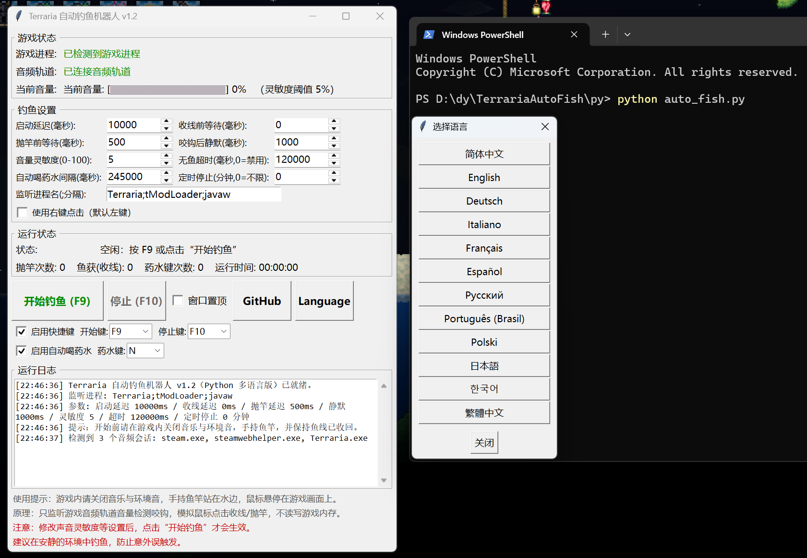

# 泰拉瑞亚自动钓鱼机器人（多语言版）v1.1

一个**多语言界面**的泰拉瑞亚（Terraria）全自动钓鱼机器人。

由`PPLLAAS258`使用`DeepSeek`辅助编程

> 参考原作：Izzy's Fishing Bot v2.00，作者 D.RU$$ (RussDev7)。

参考 `Izzy's Ultimate Fishing Toolkit` 的 `Izzy's Fishing Bot v2.00` GitHub项目的C#源码，按其工作原理使用`python`重写并汉化支持多语言。

[原作者lzzy的GitHub项目地址](https://github.com/RussDev7/Izzy-s-Ultimate-Fishing-Toolkit)

程序界面支持12种语言

**简体中文/English/Deutsch/Italiano/Français/Español/Русский/Português (Brasil)/Polski/日本語/한국어/繁體中文**

程序界面会自动匹配文本大小

<p align="center">
  
</p>

## 🚀 快速开始（推荐：打包好的Python的exe 版，无需编译或python环境）

| 运行方式 |
 **直接打开使用Python打包后的exe版（推荐）**
 
 **如果你没有安装`python`请前往官网下载 `https://www.python.org/`**
 
 **进入目录右键打开PowerShell(终端)执行  `python auto_fish.py` **

### 目录结构

```
TerrariaAutoFish
    ├── auto_fish.py           ← Python 版主程序
    ├── TerrariaAutoFish.exe   ← 已打包好的成品（双击即用，无需 Python）
    ├── TerrariaAutoFishPy.ini  ← Python 版配置
    ├── README.md              ← 本文档
```
> 打包编译成exe方法：在**能运行 python 的 PowerShell (终端)**里右键目录然后使用 **PowerShell (终端)**打开后依次执行下面两条命令：
> ```
> python -m pip install pyinstaller
> python -m PyInstaller -F -w -n TerrariaAutoFish --noconfirm --distpath . auto_fish.py
> ```
> 若 pip 下载慢，可加国内镜像：`python -m pip install pyinstaller -i https://pypi.tuna.tsinghua.edu.cn/simple`
> 若工作区里存在参考项目的 `Golden_Rod.ico`，打包时会自动用作程序图标。
---

## 一、工作原理

```
游戏音频 ──> Windows 声音驱动（CoreAudio/WASAPI 音频会话）
                │
                ▼
     按进程名找到游戏的"音频轨道"（默认 Terraria / tModLoader / javaw）
                │
                ▼
     实时读取该轨道的峰值音量（VU 0~100%）
                │
                ▼
   VU ≥ 灵敏度阈值（鱼"咬钩"的那声水花音效）
                │
                ▼
   模拟鼠标左键点击 ── 收线（鱼入背包）
                │
                ▼
   等待抛竿延迟后再次点击 ── 重新抛竿
                │
                ▼
   静默等待（过滤落水声）── 继续监听 ── 循环……
```

- **只依赖声音驱动**：监听来自游戏进程音频轨道的任何声音，以此判断咬钩；
- **只发鼠标宏**：点击发送到当前光标位置，与游戏进程无任何内存读写（无注入、无作弊特征）；
- **100% 全自动循环**：咬钩 → 收线 → 重新抛竿 → 继续监听，周而复始；
- **无鱼保护**：超过"无鱼超时"仍未咬钩会自动收线重抛，防止浮漂失效卡住；
- **定时停止**：可设置钓满 N 分钟后自动停止，适合挂机过夜。

---

## 二、使用方法

1. **进入游戏世界**，找一个安静的水边（钓鱼环境）；
2. 打开游戏设置：**关闭"音乐"和"环境音"**（这一步很重要，能大幅减少误触发）；
3. 手持**鱼竿**，确保**鱼线已收回**（画面中没有浮漂）；
4. 把**鼠标指针悬停在游戏画面上**，并让游戏窗口处于前台（建议窗口化 + 勾选本工具的"窗口置顶"）；
5. 点 **开始钓鱼**（默认快捷键 F9）—— 机器人会先等待"启动延迟"（默认 10 秒，给你时间切回游戏），然后自动抛竿；
6. 想停止就按**停止快捷键**（默认 F10）或点"停止"按钮。
7. 若快捷键与其他程序冲突：界面"窗口置顶"下方可以**关闭快捷键**，或把开始/停止键改成其他 F1~F12 键。

> ⚠️ 点击是通过系统鼠标宏发送的，会点在**当前光标位置**。
> 所以钓鱼期间请保持鼠标停在游戏画面上、游戏窗口在前台，不要移动鼠标去干别的。
> 若游戏以**管理员身份**运行，本工具也需要以管理员身份运行。

### 界面说明

| 区域 | 内容 |
| --- | --- |
| 游戏状态 | 游戏进程是否检测到、音频轨道是否连接、**实时音量条**（校准灵敏度就靠它） |
| 钓鱼设置 | 全部延迟/阈值参数（详见下表） |
| 运行状态 | 当前阶段（静默等待/监听中/收线中…）、抛竿次数、鱼获数、运行时间 |
| 快捷键设置 | 位于"窗口置顶"下方：**启用快捷键**开关（默认开，可关闭避免冲突）+ 开始键/停止键下拉框（F1~F12 任选，改完立即生效，按钮文字同步更新） |
| 自动喝药水设置 | 位于快捷键设置下方：**启用自动喝药水**开关（默认关）+ 药水键下拉框（A~Z 26 个字母任选，默认 N）；勾选后，**仅在钓鱼机器人正在运行且游戏进程存在时**，每隔设定时间自动模拟按下喝钓鱼药水的快捷键一次，获取钓鱼增益（Fishing Potion Buff）；机器人未开始或已停止时不执行 |
| GitHub 按钮 | 位于"窗口置顶"右侧：点击打开"关于"窗口，内含"访问原作者 GitHub"按钮，点击可在浏览器中打开原作者项目主页 |
| Language 按钮 | 位于 GitHub 按钮右侧（按钮本身不翻译）：点击弹出语言选择框，可选 12 种语言（英语/德语/意大利语/法语/西班牙语/俄语/简体中文/巴西葡萄牙语/波兰语/日语/朝鲜语/繁体中文），语言名以各自母语显示；选择后整个界面立即切换语言并自动保存，下次启动保持 |
| 运行日志 | 每次咬钩、收线、抛竿、停止都有时间戳记录 |

### 参数说明

| 参数 | 默认 | 说明 |
| --- | --- | --- |
| 启动延迟 | 10000 毫秒 | 点开始后延迟多久才抛第一竿（给你时间切回游戏） |
| 收线前等待 | 0 毫秒 | 检测到咬钩后延迟多久收线（咬钩音效刚响时浮漂正在下沉，立即收线成功率最高） |
| 抛竿前等待 | 500 毫秒 | 收线后延迟多久重新抛竿（给收线动画/拾取时间） |
| 咬钩后静默 | 1000 毫秒 | 抛竿后静默多久再开始监听（过滤落水声，防止误触发） |
| 音量灵敏度 | 5（0~100） | 音量达到多少算"咬钩"。**校准方法见下** |
| 无鱼超时 | 120000 毫秒 | 多久没鱼就自动收线重抛，0=禁用 |
| 自动喝药水间隔 | 245000 毫秒（4分5秒，仅首次无配置文件时的默认值） | 钓鱼机器人运行时，每隔**玩家在 ini/界面上设置的时间**自动按下喝钓鱼药水的快捷键（默认 N）获取钓鱼增益；带上下箭头，每点一次增减 60000 毫秒（1 分钟） |
| 定时停止 | 0 分钟 | 钓满 N 分钟自动停止，0=不限 |
| 监听进程名 | `Terraria;tModLoader;javaw` | 要监听的进程名（分号分隔，可带 .exe）。泰拉瑞亚本体是 `Terraria`，TML 模组版是 `tModLoader`，`javaw` 兼容原版工具基于 Java 进程轨道的用法 |
| 使用右键点击 | 关 | 默认模拟左键（游戏里钓鱼就是左键），个别改键玩家可勾选切换为右键 |

> 除"监听进程名"外的所有数值设置项都带 **上下箭头**：
> 点击箭头即可按步进加减数值（启动延迟步进 1000、延迟项步进 100、灵敏度步进 2、定时停止步进 1 分钟）2、自动喝药水间隔步进 60000、定时停止步进 1 分钟），也可以直接点击数字手动输入。
> 🧪 **自动喝药水说明**：把钓鱼药水放在背包里，勾选"启用自动喝药水"（默认药水键 N，可在下拉框改成你游戏里设置的增益键），机器人钓鱼期间就会每隔设定时间自动喝一瓶钓鱼药水，持续获得钓鱼增益（Fishing Potion Buff）。启动与每次按键都会写入运行日志（与其他日志格式一致）；每成功发送一次按键，"运行状态"里的"药水键次数"就 +1（点开始/停止不清零，仅退出程序时清空），每轮钓鱼结束时也会在日志里报告本轮喝药水次数。

### 🎯 灵敏度校准（推荐第一次使用前做一次）

1. 界面"游戏状态"里有一个**实时音量条**（`[████░░░░] 35%`）；
2. 开着游戏正常钓鱼，观察：水面静止时音量大概是多少（背景噪音），鱼咬钩瞬间音量冲到多少；
3. 把"音量灵敏度"设为**背景噪音与咬钩音量之间**的值（例如静止 2%、咬钩 20%，就填 8~12）；
4. 环境嘈杂（下雨、僵尸声、音乐没关）时适当调高。

---

## 三、常见问题

**Q：点了开始没反应 / 提示未检测到游戏进程？**
A：确认游戏已启动且进程名在"监听进程名"列表里（本体=Terraria，TML=tModLoader）。用任务管理器核对实际进程名。

**Q：一直钓不到鱼，日志里没有"检测到咬钩"？**
A：多半是灵敏度设高了，或游戏没声音。① 看实时音量条在咬钩时有没有明显尖峰；② 若音量条一直为 0，打开系统"音量合成器"确认游戏有声音输出；③ 调低灵敏度重试。

**Q：疯狂误触发（没咬钩也收线）？**
A：灵敏度设低了。关闭游戏音乐/环境音，找个安静水域，按上面方法重新校准。

**Q：提示未找到音频轨道？**
A：确认游戏在出声。部分设备（蓝牙耳机切换、独占模式）会创建新会话，稍等 1~2 秒工具会自动找到。

**Q：安全吗？会不会被封？**
A：本工具与参考原作一样，完全外部：只读系统音频会话的音量、只发鼠标宏，不读取/写入游戏内存，不注入。泰拉瑞亚本身无反作弊；本工具也不改游戏文件、不开机自启动。

---

## 四、免责声明

本工具仅用于学习编程与自动化技术。请遵守游戏服务条款，仅在自己的单人世界中使用；因使用本工具产生的任何后果由使用者自行承担。
